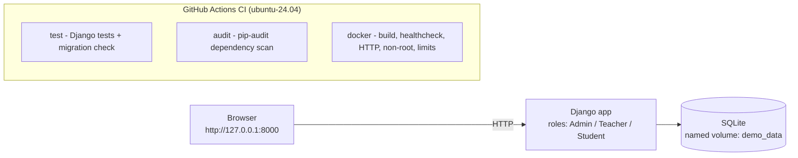

# AG Learning Platform Demo

A small, self-contained **Django learning-management system (LMS)** demo:
authentication with three roles, courses with ordered lessons, student
enrollments, role-based dashboards, and a public JSON API. It runs locally with
**Docker Compose** on **SQLite**.

It is also a hands-on **DevOps portfolio project**: containerisation, a GitHub
Actions CI pipeline, automated tests, dependency-vulnerability scanning,
least-privilege container execution, healthchecks and resource limits, and
reproducible pinning of dependencies, the base image and CI actions.

> **Disclaimer.** This is an independent, public demo. All data is fictional, it
> runs **locally only**, and it is **not production-ready**. It contains no real
> secrets, customer data, or private production code, and it is not a
> source-code release of any commercial product. Do not deploy it as-is.

## Technologies and demonstrated skills

| Area | Technologies and demonstrated practice |
| --- | --- |
| Language / framework | Python 3.12, Django 5.2 (ORM, auth, admin, sessions) |
| Linux / shell | POSIX `sh` launcher, Linux-first Docker workflow |
| Containers | Docker, Docker Compose v2, digest-pinned base image |
| CI/CD | GitHub Actions, three jobs, SHA-pinned actions, `contents: read` |
| Testing | Django test suite (23 tests) and a launcher suite using a mocked Docker CLI |
| Security | Non-root container, dropped capabilities, `no-new-privileges`, `pip-audit`, Dependabot, no committed secrets |
| Reliability | Healthcheck, restart policy, graceful shutdown, CPU/memory/PID and log limits |
| Reproducibility | Pinned Python dependencies, digest-pinned image, SHA-pinned actions |
| Operations | One-command launchers with scripted diagnostics and secret redaction |

## Demo architecture

Architecture of the **public demo only**.



Stack: Django 5.2, SQLite, server-rendered templates, original CSS. No JavaScript
build step and no frontend framework or CDN.

## Quick Start

Requirements: Docker Engine and Docker Compose v2. The launcher checks Docker,
picks a free local port, starts the stack, waits until it is actually reachable,
and prints the URL and demo logins. It never installs software and never deletes
data; `Ctrl+C` stops it safely.

**Linux / macOS**

```bash
git clone https://github.com/MohammadRezaHeydari-se/AG-Learning-Platform-Demo.git
cd AG-Learning-Platform-Demo
./start.sh
```

**Windows (PowerShell 5.1+ or PowerShell 7+, no WSL required)**

```powershell
git clone https://github.com/MohammadRezaHeydari-se/AG-Learning-Platform-Demo.git
cd AG-Learning-Platform-Demo
powershell -ExecutionPolicy Bypass -File .\start.ps1
```

Both launchers publish the service on `127.0.0.1` only, prefer port **8000**, and
fall back to the next free port when it is busy. Open the URL the launcher prints
(for example **http://127.0.0.1:8000/**, login at **/login/**). The container runs
migrations and seeds the fictional demo data on first start, so the first run can
take a few seconds to become ready.

### Manual start (Docker Compose)

```bash
docker compose up --build -d     # set HOST_PORT=8001 to publish elsewhere
docker compose down              # stop; keeps the named volume and your data
docker compose down -v           # stop and erase the demo database
```

### Run without Docker (local development)

```bash
python3 -m venv .venv
source .venv/bin/activate          # Windows: .venv\Scripts\activate
pip install -r requirements.txt
cp .env.example .env
python manage.py migrate
python manage.py seed_demo
DJANGO_DEBUG=true python manage.py runserver
```

`DJANGO_DEBUG=true` is only needed here so Django serves static files during
local development; the default is `DEBUG=false`.

## Demo features and test accounts

- Django authentication (login, logout, sessions, hashed passwords) with
  role-based access control and three roles: **Admin**, **Teacher**, **Student**.
- Courses with an assigned teacher, ordered lessons, and student enrollments.
- Role-based dashboards for each role.
- Server-side permissions and published-content visibility: students see
  published lessons only; teachers and admins see all lessons in the courses they
  own or administer.
- Public JSON API: `GET /api/courses/` lists published courses.
- Idempotent, fictional demo-data seeding (safe to re-run).
- Responsive homepage with a course catalog, using original CSS.

Fictional local-only accounts (created by the seed command):

| Role | Username | Password |
| --- | --- | --- |
| Admin | `demo_admin` | `demo-admin-pass` |
| Teacher | `demo_teacher` | `demo-teacher-pass` |
| Student | `demo_student` | `demo-student-pass` |

Passwords are applied only **when the accounts are first created**; if you change
one, the existing account keeps your new password. Never reuse these values
outside local development.

## CI/CD pipeline

`.github/workflows/ci.yml` runs on every push and pull request on `ubuntu-24.04`,
with `permissions: contents: read` and superseded runs cancelled automatically.
It has three independent jobs:

- **`test`** — install pinned dependencies, `manage.py check`, the Django test
  suite, and `makemigrations --check --dry-run` to catch migration drift.
- **`audit`** — run `pip-audit` over the pinned runtime dependencies to flag known
  vulnerabilities.
- **`docker`** — build the image, start it with Compose in a run-scoped project,
  wait (bounded to 180s) for the container to become `healthy`, verify HTTP 200
  from `/` and `/api/courses/`, confirm the Django process is **non-root**, check
  the memory/CPU/PID limits, collect redacted diagnostics on failure, and always
  tear down the CI-created resources.

Dependencies and CI actions are updated by **Dependabot** (weekly, for both `pip`
and `github-actions`).

## Docker security and reliability controls

- **Least-privilege runtime.** The entrypoint fixes volume ownership, then drops
  to the unprivileged `app` user; Django runs as a **non-root** process. The
  container uses `no-new-privileges` and drops all Linux capabilities except
  `CHOWN`, `SETUID`, `SETGID`, which are needed only at startup.
- **Healthcheck.** `compose.yaml` probes `http://127.0.0.1:8000/` with the Python
  standard library (no `curl`/`wget`); the probe exercises the home view, so it
  reflects the app and SQLite being reachable, not just a live process. A
  healthcheck records status but does **not** restart a container by itself.
- **Crash recovery.** `restart: "on-failure:5"` restarts a crashed container up to
  five times, then stops rather than looping on a persistent misconfiguration.
  A normal `docker compose down` is respected and not restarted.
- **Graceful shutdown.** `init: true` runs a small init as PID 1 to forward
  signals, and `stop_grace_period: 30s` allows in-flight SQLite writes to finish.
- **Resource and log limits.** `mem_limit: 256m`, `cpus: "0.50"`, `pids_limit: 128`
  bound a single container, and `json-file` logs are capped at `max-size: 10m`
  with `max-file: 3` (~30 MB total).
- **Secrets hygiene.** No secret is committed. `DJANGO_SECRET_KEY` is optional;
  when unset, a strong key is generated on first run and persisted on the
  `demo_data` volume (`/app/data/django_secret_key`) so sessions survive restarts.
  `.env`, the generated key and databases are git-ignored; only `.env.example` is
  committed. The launcher masks anything that looks like a password or secret key
  in the logs it prints.

## Limitations and scope

- **Local demo, not production.** It uses Django's development server, SQLite,
  and no HTTPS. It is not hardened for, or intended for, production deployment.
- No self-service signup, password-reset email flow, or background workers.
- One teacher per course; minimal templates with no frontend build tooling.
- CI runs on Linux (`ubuntu-24.04`) and runs the Django test suite only. The
  launcher suite (`sh tests/launcher_test.sh`, mocked Docker, run locally) covers
  the Linux launcher; the PowerShell launcher is covered by a parser/self-test
  check. Neither is a native Windows/macOS run.
- No reuse license is granted at this stage.

This repository is an **independent implementation** built for learning and
portfolio purposes. Any commercial platform the author also works on is a
**separate, private** codebase: its architecture, infrastructure and data are not
included here, and nothing in this demo should be read as describing or
validating that system.

## Repository layout and commands

```
config/       Django settings, URLconf, WSGI
courses/      models, roles, permissions, views, urls, admin, tests
  templates/  server-rendered HTML
  static/     original CSS
  management/commands/seed_demo.py
compose.yaml  local SQLite stack with a named volume
Dockerfile    digest-pinned python:3.12-slim image
docker-entrypoint.sh  privilege drop + startup
start.sh      one-command launcher (Linux/macOS)
start.ps1     one-command launcher (Windows PowerShell)
tests/        launcher test suite (mocked Docker)
.github/      CI workflow and Dependabot config
```

Common commands:

```bash
python manage.py check                         # Django system check
python manage.py test                          # Django test suite
python manage.py makemigrations --check --dry-run   # migration drift check
sh tests/launcher_test.sh                      # launcher tests (mocked Docker)
docker compose logs web                         # container logs
```

If a launcher step fails it prints the failed step, a likely cause, an actionable
next step, and the last container log lines with secret-like values masked.
Typical fixes: Docker not installed or not running; the Compose v2 plugin missing;
port 8000 already in use (set `HOST_PORT`); or a login failing because a demo
password was changed (`python manage.py changepassword demo_admin`).
