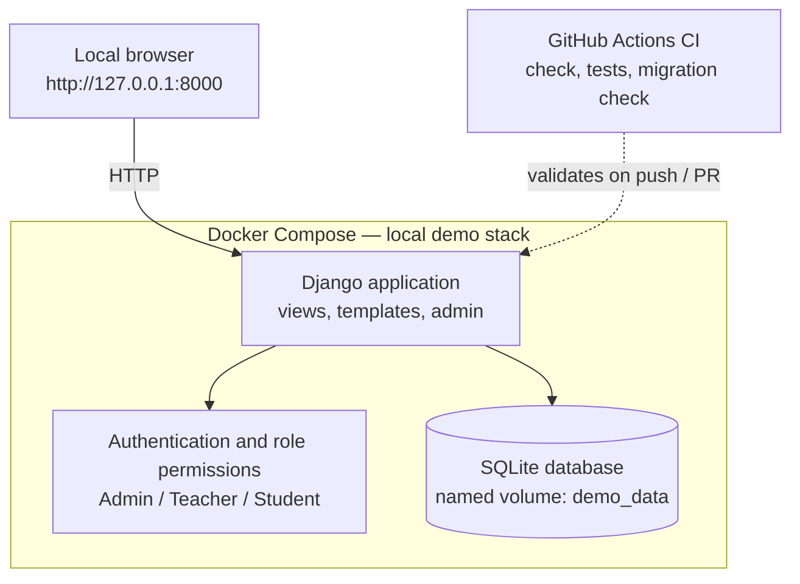

# AG Learning Platform Demo

A small Django learning-management demo with roles, courses, lessons and a clean
responsive UI.

> **Local development only.** This is a portfolio demo. Data is fictional, it is
> **not production-ready**, and it contains no real secrets, customer data or
> private production code.

## Relationship to Automationsguiden LMS

- **Automationsguiden** is a live Swedish learning platform focused on industrial
  automation and technical education.
- Its general LMS concept includes structured courses, educational content, and
  learning workflows.
- The production codebase and infrastructure repositories remain **private**.
- This public demo is an **independent implementation**, intentionally simplified,
  and it uses **fictional data**.
- It is **not** a production source-code release, an exact replica, or a complete
  feature inventory of the production platform.

## Quick Start

The launcher checks Docker, picks a free local port, starts the stack, waits
until it is actually reachable, and prints the URL and the demo logins.

> The launcher never installs Docker and never deletes data. It only starts
> (or reuses) the local container. Press `Ctrl+C` at any time to stop it safely.

**Linux / macOS**

```bash
git clone https://github.com/MohammadRezaHeydari-se/AG-Learning-Platform-Demo.git
cd AG-Learning-Platform-Demo
./start.sh
```

**Windows (PowerShell)**

```powershell
git clone https://github.com/MohammadRezaHeydari-se/AG-Learning-Platform-Demo.git
cd AG-Learning-Platform-Demo
powershell -ExecutionPolicy Bypass -File .\start.ps1
```

Both launchers publish the service on `127.0.0.1` only and prefer port **8000**,
falling back to the next free port when it is busy. Either way you can open:

- Home: **http://127.0.0.1:8000/** (the launcher prints the exact URL)
- Login: **http://127.0.0.1:8000/login/**

The container runs migrations and seeds the demo data automatically on first
start. It can take a few seconds to become ready.

### What the launcher shows

Both launchers walk through a numbered checklist and a live progress bar whose
percentage is the share of setup steps actually completed (never a time
estimate). Each step is tagged:

| Tag | Meaning |
| --- | --- |
| `[OK]` | Step completed (for example, Docker detected). |
| `[RUNNING]` | Step in progress (for example, building or waiting). |
| `[SKIP]` | Step not needed because something was reused. |
| `[ERROR]` | Step failed; the launcher then prints the cause and next step. |

Steps: Docker CLI, Docker Engine, Compose v2, existing container/image, port
selection, image build, container start, migrations/seeding, HTTP readiness.
The bar only reaches **100%** once the app actually answers over HTTP.

- If the demo is already running you will see
  `Existing AG Learning Platform container detected.` and
  `Reusing existing container — no rebuild or dependency installation needed.`
- On a first run the Python dependencies are installed **inside the Docker
  image**, not on your host OS, and the Docker build output is streamed live.
- Console output is plain (no colour or control characters) when the output is
  redirected or when `NO_COLOR` is set, so it stays readable in CI logs.

### Manual start (Docker Compose)

If you prefer to run Docker directly:

```bash
docker compose up --build -d
```

Set `HOST_PORT` to publish on a different local port (default `8000`):

```bash
HOST_PORT=8001 docker compose up --build -d
```

## Demo logins

| Role | Username | Password |
| --- | --- | --- |
| Admin | `demo_admin` | `demo-admin-pass` |
| Teacher | `demo_teacher` | `demo-teacher-pass` |
| Student | `demo_student` | `demo-student-pass` |

These passwords are applied **when the demo accounts are first created**. If you
have run this demo before and changed a password, the existing account keeps the
password you set — that is expected.

## Stop the demo

```bash
docker compose down
```

This stops the service and **keeps** your data (the named volume). Only add `-v`
if you deliberately want to erase the demo database and start fresh.

## Features

A minimal, readable example of the following capabilities, using only what is
verified in this repository:

- Django authentication (login, logout, sessions, hashed passwords) with
  role-based access control.
- Three roles: **Admin**, **Teacher**, and **Student** (Django users and groups).
- Courses with an assigned teacher, ordered lessons, and student enrollments.
- Role-based dashboards for each role.
- Server-side permissions and published-content visibility: students see
  published lessons only, while teachers and admins see all lessons in the
  courses they own or administer.
- Public JSON API: `GET /api/courses/` lists published courses.
- Idempotent, fictional demo-data seeding (safe to re-run).
- Docker Compose local setup with SQLite and a named volume.
- One-command launchers for Linux/macOS (`start.sh`) and Windows PowerShell
  (`start.ps1`).
- Automated tests and GitHub Actions CI.
- Public homepage with a course catalog, responsive layout, and original CSS
  (no framework or CDN).

## Demo Architecture

This is the architecture of the **public demo** only. It is not the production
architecture of Automationsguiden.



Stack: Django 5.2, SQLite, server-rendered templates. No JavaScript build step.

### Project layout

```
config/       Django settings, URLconf, WSGI
courses/      models, roles, permissions, views, urls, admin, tests
  templates/  server-rendered HTML
  static/     original CSS
  management/commands/seed_demo.py
compose.yaml  local SQLite stack with a named volume
Dockerfile    python:3.12-slim local image
start.sh      one-command launcher (Linux/macOS)
start.ps1     one-command launcher (Windows PowerShell)
tests/        launcher tests
.github/      GitHub Actions CI
```

### Roles

| Role | Access |
| --- | --- |
| Admin | Full Django admin; opens every course and all lessons (including drafts). |
| Teacher | Courses assigned to them; sees all lessons in those courses. |
| Student | Enrolled courses; sees published lessons only. |
| Anonymous | Homepage and API only; other pages redirect to login. |

## Local development without Docker

```bash
python3 -m venv .venv
source .venv/bin/activate          # Windows: .venv\Scripts\activate
pip install -r requirements.txt
cp .env.example .env
python manage.py migrate
python manage.py seed_demo
DJANGO_DEBUG=true python manage.py runserver
```

`DJANGO_DEBUG=true` is needed here so Django serves the static files during local
development, since the default is `DEBUG=false`.

## Tests

```bash
python manage.py check
python manage.py test
python manage.py makemigrations --check --dry-run
sh tests/launcher_test.sh
```

Covers roles, authentication, login/logout, dashboards, lesson permissions,
lesson visibility, the homepage, the API and idempotent seeding. The launcher
tests use mocked Docker to check the start scripts without touching containers.

## CI

`.github/workflows/ci.yml` runs on every push and pull request: install
dependencies, `check`, `test`, then `makemigrations --check --dry-run`.

## Security notes

- Local development demo: Django's development server, SQLite, no HTTPS.
- The service is published on `127.0.0.1` only.
- `DEBUG` defaults to **false**. Enable it only for local development by setting
  `DJANGO_DEBUG=true` (in `.env` or on the command line).
- No secret is committed. `DJANGO_SECRET_KEY` is optional; if unset, a strong key
  is generated on first run and persisted on the `demo_data` volume
  (`/app/data/django_secret_key`), so it survives restarts and is never printed
  to the terminal. The `DEMO_*_PASSWORD` values are fictional placeholders for
  local use — never reuse them in production.
- The container runs as an unprivileged user with `no-new-privileges` and all
  Linux capabilities dropped except the minimum needed to fix volume ownership
  and drop privileges at startup.
- `.env`, the generated secret key and databases are git-ignored; only
  `.env.example` is committed.

## Reliability and resource limits

This is a local-only demo, not a production deployment; the settings below keep
it recoverable and bounded on a single machine.

- **Health states.** `compose.yaml` defines a `healthcheck` that probes
  `http://127.0.0.1:8000/` with the Python standard library (no `curl`/`wget`).
  `docker compose ps` shows `starting` → `healthy` (or `unhealthy`). The probe
  exercises the home view, which reads from SQLite, so it reflects the app and
  its database being reachable — not just a live process.
- **Healthcheck does not restart containers.** Docker only records the health
  status. An `unhealthy` container is **not** restarted automatically by a
  healthcheck; restarting an unhealthy container would require extra tooling,
  which this demo intentionally avoids.
- **Crash restart behaviour.** The service uses `restart: "on-failure:5"`, so a
  container that exits with an error is restarted up to 5 times (and gives up
  rather than looping forever on a persistent misconfiguration). A normal
  `docker compose stop` / `down` is respected and is not restarted.
- **Graceful shutdown.** `init: true` runs a small init as PID 1 to forward
  signals, and `stop_grace_period: 30s` gives the server time to finish
  in-flight SQLite writes before Docker escalates to `SIGKILL`.
- **Resource limits.** Each run is capped at `mem_limit: 256m`,
  `cpus: "0.50"` and `pids_limit: 128` — conservative bounds for a single
  Django + SQLite process that prevent one container from exhausting the host.
- **Log rotation.** Container logs use the `json-file` driver with
  `max-size: 10m` and `max-file: 3`, so logs are bounded to roughly 30 MB
  instead of growing without limit. This does not change Docker daemon
  (global) settings.

## Troubleshooting

When a step fails the launcher prints the failed step, the likely cause, an
actionable next step, and the last 50 container log lines (with anything that
looks like a password or secret key masked). Use that output first.

- **`[ERROR]` at Docker CLI detection:** Docker is not installed. Install Docker
  Desktop or Docker Engine + Compose v2, then rerun.
- **`[ERROR]` at Docker Engine:** Docker is installed but not started. Start
  Docker Desktop (or the Docker service) and rerun.
- **`[ERROR]` at Compose v2 detection:** enable the `docker compose` v2 plugin.
- **`[ERROR]` at image build / container start:** read the streamed build output
  and the sanitized logs the launcher prints.
- **`[ERROR]` at HTTP readiness:** the container started but did not answer in
  time; wait and rerun, or check `docker compose logs web`.
- **Port 8000 in use:** `start.sh` / `start.ps1` pick the next free port
  automatically. To choose one yourself, set `HOST_PORT`, e.g.
  `HOST_PORT=8001 ./start.sh` or `$env:HOST_PORT=8001; .\start.ps1`.
- **Login fails:** the demo passwords only apply to newly created accounts. If a
  password was changed, sign in with the new one, or set an admin password with
  `python manage.py changepassword demo_admin`.
- **`permission denied` with Docker on Linux:** make sure your user can run Docker.

## Ongoing Engineering Improvements

Ongoing areas of work in this demo. These are in progress, not completed
certifications, audits, or verified production outcomes.

- **Performance and maintainability** — keeping the code small and readable,
  reducing duplication, and reviewing query and page performance.
- **Security reviews and hardening** — reviewing authentication, permissions,
  input handling, and dependency updates.
- **Reliability and troubleshooting** — improving the launcher, error reporting,
  and recovery paths.
- **Deployment and automation** — refining Docker and CI workflows and exploring
  simple, reproducible deployment options.

## Limitations

- Django development server, SQLite, no production hardening.
- No self-service signup or password-reset email flow.
- One teacher per course.
- Minimal templates and no frontend build tooling, by design.

No reuse license is granted at this stage.
